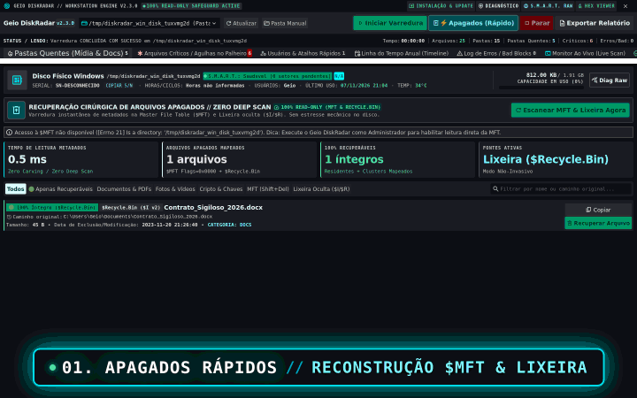

# Geio DiskRadar (v2.3.0) — Triador Forense e Indexador Read-Only de HDs e SSDs

Software desktop para triagem rapida, forense e **100% Read-Only (somente leitura)** de discos rigidos (HDs) e unidades de estado solido (SSDs) conectados via Dock USB, SATA ou adaptadores de bancada. Desenvolvido para peritos, tecnicos de hardware, recuperadores de ativos e analistas de seguranca da informacao que precisam avaliar lotes de discos descartados ou sucata sem alterar metadados na unidade inspecionada.


---

## Download e Instalacao no Windows

| Metodo | Procedimento | Requisitos |
|---|---|---|
| **Instalador Oficial (.exe)** | [Baixar Geio_DiskRadar_Setup_v2.3.0.exe](https://github.com/6310/diskradar/releases/latest) | Nenhum. Executavel autonomo com Python embutido. Instalacao guiada em dois cliques. |
| **Instalador Automatizado (.bat)** | Baixe o codigo em ZIP, descompacte e execute `Instalar_DiskRadar.bat`. | Configura a instalacao central em `%LocalAppData%\Programs\GeioDiskRadar` e atalhos na Area de Trabalho. |

---

## Modulos do Sistema

### 1. Estacao Forense Stitch
Interface unificada composta por 10 telas e modais analiticos integrados ao motor de inspecao:

- **Pastas Quentes (`pastas-quentes`):** Cartoes Bento de telemetria, filtros por categoria (Fotos, Videos, Documentos, Misto) e ordenacao por Relevancia Forense (0 a 100 pontos), Volume, Quantidade e Recencia.
- **Arquivos Criticos (`arquivos-criticos`):** Classificacao em 10 categorias prioritarias (carteiras cripto, sementes BIP-39, bancos de dados, arquivos financeiros, codigos-fonte, bancos de senhas, backups e imagens de disco).
- **Recuperacao Rapida de Arquivos Apagados (`arquivos-apagados`):** Mapeamento e reconstrucao de registros deletados na MFT do NTFS e no `$Recycle.Bin` sem varrer setores fisicos (Zero Deep Scan).
- **Arvore de Usuarios e Atalhos (`usuarios-atalhos`):** Deteccao de perfis locais com navegacao direta para Desktop, Documents, Downloads, AppData, navegadores e chaves SSH.
- **Linha do Tempo de Atividade (`linha-do-tempo`):** Distribuicao cronologica de modificacao de arquivos por ano, identificando picos de uso do equipamento.
- **Log de Erros Fisicos e Bad Blocks (`log-erros`):** Contadores de incidentes de I/O, falhas de leitura fisica e exportacao de relatorios de diagnostico.
- **Inspetor Hexadecimal Read-Only (`modal-hex`):** Leitura de blocos de 512 bytes, calculo de Entropia de Shannon (0.00 a 8.00 bits/byte), identificador de Magic Numbers (Berkeley DB, SQLite, ZIP, PDF, KDBX, DWG, PST) e visualizador de tipos numericos em tempo real.
- **Diagnostico S.M.A.R.T. Detalhado (`modal-smart`):** Tabela de saude eletromecanica, atributos criticos e telemetria bruta em hexadecimal e decimal.



### 2. Motor de Varredura Assincrono Anti-Travamento
- Execucao multithread isolada com fila thread-safe (`queue.Queue`) e snapshots de telemetria.
- Filtro inteligente de diretorios de sistema e cache (`Windows`, `Program Files`, `node_modules`, `.git`, caches de navegadores) para otimizar velocidade de varredura.
- Sondagem cirurgica em caminhos especificos de alto valor probatorio.

---

## Estrutura do Repositorio

```text
diskradar/
|-- main.py                 # Ponto de entrada (interface Stitch ou CustomTkinter via --classic)
|-- requirements.txt        # Dependencias de producao
|-- version.json            # Metadados de versao SemVer, GUID do aplicativo e URLs de update
|-- .env.example            # Variaveis de ambiente opcionais
|-- .gitignore              # Regras de exclusao de artefatos temporarios e segredos
|-- run_linux.sh            # Script de inicializacao rapida em ambiente Linux
|-- Executar_DiskRadar.bat  # Inicializador direto no Windows sem instalacao
|-- Instalar_DiskRadar.bat  # Instalador canonico em lote para Windows
|-- Desinstalar_DiskRadar.bat # Desinstalador e limpador de registros
|-- Compilar_EXE.bat        # Compilador automatizado PyInstaller + Inno Setup
|-- LEIAME.txt              # Instrucoes tecnicas para o operador Windows
|-- README.md               # Documentacao principal
|-- core/                   # Motor forense e modulos de inspecao
|   |-- bip39.py            # Dicionario oficial e detector de sementes BIP-39 (12 e 24 palavras)
|   |-- classifier.py       # Algoritmos de classificacao, pontuacao e agrupamento
|   |-- deleted_scanner.py  # Parser binario de NTFS $MFT e $Recycle.Bin (sem Deep Scan)
|   |-- diagnostics.py      # Autodiagnostico de ambiente, permissao e dependencias
|   |-- disk_info.py        # Coleta de hardware, numero de serie, particoes e telemetria
|   |-- evidence.py         # Extracao de evidencias com hash SHA-256 e manifesto de custodia
|   |-- explorer_bridge.py  # Integracao com Windows Explorer (/select) com protecao anti-reentrancia
|   |-- exporter.py         # Exportador de relatorio forense estatico em HTML
|   |-- hex_inspector.py    # Leitor de blocos binarios e calculo de Entropia de Shannon
|   |-- installer.py        # Motor de instalacao canonica, SemVer e auto-update OTA
|   |-- rules.py            # Definicoes de categorias, assinaturas e extensoes de interesse
|   `-- scanner.py          # Varredor de disco em thread dedicada
|-- installer/              # Configuracoes de empacotamento
|   |-- diskradar_setup.iss # Script oficial do Inno Setup 6 (instalador executavel)
|   `-- file_version_info.txt # Metadados de versao PE do Windows (VSVersionInfo)
|-- tests/                  # Suite de testes unitarios e de integracao
`-- ui/                     # Camada de apresentacao grafica
    |-- app.py              # Interface nativa CustomTkinter (modo classico)
    |-- stitch_server.py    # Servidor HTTP local e disparador de janela desktop
    |-- stitch_template.py  # Frontend SPA com componentes forenses
    `-- assets/             # Icones e recursos graficos
```

---

## Execucao

### Linux (Ambiente de Desenvolvimento ou Pericia):
```bash
# Execucao padrao com a interface Stitch
python3 main.py

# Modo alternativo (interface CustomTkinter classica)
python3 main.py --classic
```

### Windows:
- **Instalador executavel:** Execute `Geio_DiskRadar_Setup_v2.3.0.exe` e siga o assistente.
- **Execucao direta do repositorio:** Execute `Executar_DiskRadar.bat`.
- **Instalacao a partir do fonte:** Execute `Instalar_DiskRadar.bat`.
- **Compilacao local do executavel e instalador:** Execute `Compilar_EXE.bat`.

---

## Suite de Testes

Para executar os testes unitarios automatizados:

```bash
python3 -m unittest discover -s tests -v
```

---

## Garantia de Seguranca Read-Only

- O Geio DiskRadar opera exclusivamente em modo somente leitura (Read-Only).
- O software nao contem rotinas de formatacao, particionamento, delecao, sobrescrita ou movimentacao de dados na unidade de origem inspecionada.
- Arquivos extraidos como evidencia ou recuperados sao gravados em pasta separada e identificados com hash criptografico SHA-256.
